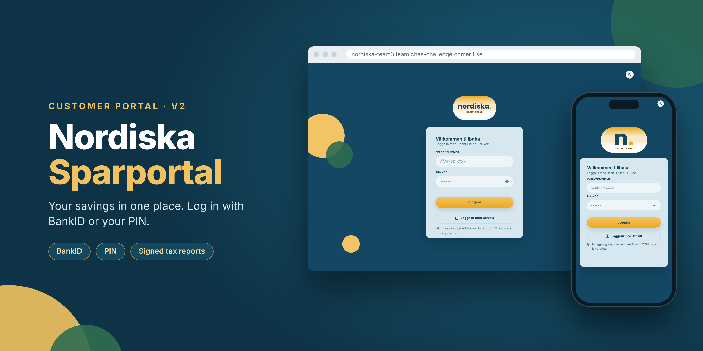
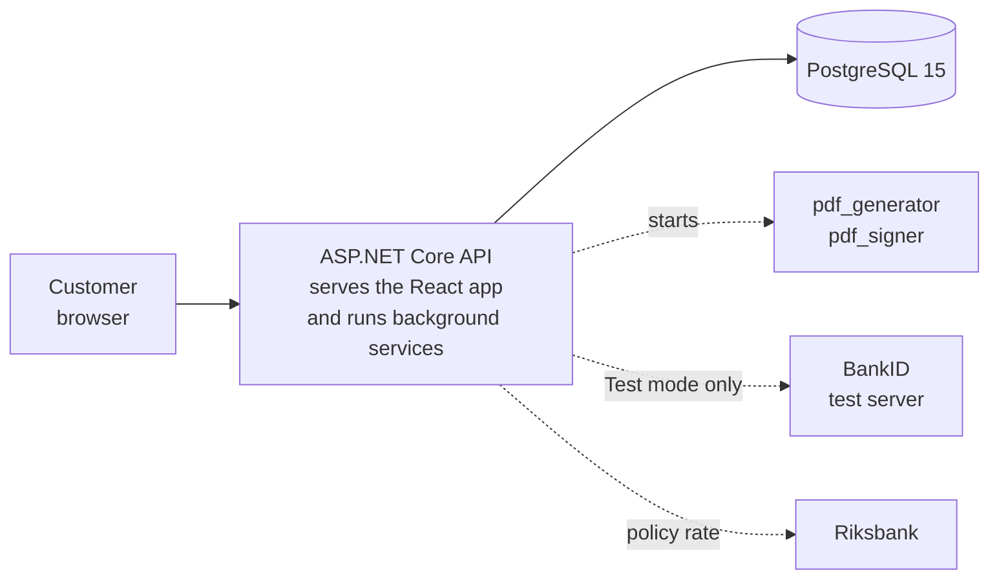

# Nordiska Sparportal v2

<p align="center">
  
</p>

<p align="center">
  
  
  
  
  
  
</p>

Team 3's rewrite of the Nordiska Sparbanken customer portal, from the v1 Razor Pages monolith to a layered v2 with a .NET 8 Web API, a React 18 frontend, PostgreSQL 15 and native C/C++ programs that create and sign tax reports.

**Try it:** [stage](https://nordiska-team3-dev.team.chas-challenge.comerit.se) · [prod](https://nordiska-team3.team.chas-challenge.comerit.se) · or [run it locally](#run-it).

## The problem

The v1 portal could not be trusted with a customer's money or login. Concurrent deposits could corrupt the balance, passwords were hashed with MD5, sessions lasted a year, and the tax report blocked the server and timed out on larger accounts.

## Our solution

**Customer portal**

- Login with PIN or BankID, with 15-minute sessions
- Overview of all savings accounts with balance and accrued interest
- Deposits, withdrawals and transfers between the customer's own accounts, booked in a ledger so the balance is always correct
- Transaction history
- Tax reports (a basis for the tax return) as PDF files that are signed and can be verified by the customer
- FAQ with ranked search and a hand-off to customer service when there is no good answer

**Behind the scenes**

- Interest from the Riksbank's policy rate plus a margin per account type, paid out on 1 January
- An audit log that records changes and that the database does not allow to be rewritten
- Personal numbers that are encrypted and masked, PIN lock after repeated failures and rate limiting

## Architecture



Database and API run as two containers in Docker Compose. This is what each part of the diagram does:

- **Customer browser.** The React app runs in the browser and only talks to the API, over HTTP with JSON. The login gives it a short-lived token, and a refresh token is kept in an `HttpOnly` cookie.
- **ASP.NET Core API.** One service that does three things. It serves the built React app, it exposes the REST endpoints in layers (Controllers, Services, Repositories), and it runs background services for tax reports, e-mail and interest. No request has to wait for those jobs.
- **PostgreSQL 15.** The only database. The balance is not stored as a number but is the sum of the `LedgerEntry` rows. Every deposit, withdrawal and transfer locks the account row and is booked in one transaction, so concurrent orders cannot give a wrong balance. The audit log is stored here as a hash chain.
- **pdf_generator and pdf_signer.** Two native programs, in C++ and C, that the API starts as separate processes (the dotted line, because they only run when a report is made). The first turns the data into a PDF and the second signs it. A report becomes `READY` only after the signature has been verified.
- **BankID test server.** Used only in `Test` mode. In `Mock` mode a fake BankID inside the API replaces it, and in `Off` mode BankID is not used at all.
- **Riksbank.** The API fetches the policy rate that the interest is based on. If the Riksbank cannot be reached, no interest is shown, and everything else keeps working.

| Layer | Technologies |
| :--- | :--- |
| **Backend** | .NET 8 / ASP.NET Core 8.0, C# 12, Entity Framework Core 8.0.30 (Npgsql 8.0.11), FluentValidation 12.1.1, Serilog 10.0.0, Swagger (Swashbuckle 6.6.2) |
| **Frontend** | React 18.3.1, TypeScript 6.0.3, Vite 8.2.2, TanStack Query 5.104.0, React Router 7.18.3, zod 4.6.5, qrcode.react 4.2.0 |
| **Native programs** | C++17 (`pdf_generator`), C11 (`pdf_signer`), libharu, nlohmann-json, OpenSSL, CMake 3.25+ |
| **Security** | BCrypt.Net-Next 4.2.0, JWT Bearer 8.0.30, refresh token in an HttpOnly cookie, AES-GCM, BankID v6 (Off, Mock and Test), rate limiting |
| **Infrastructure** | PostgreSQL 15, Docker Compose, GitHub Actions CI and deploy, Node.js 20 for the frontend build |
| **Testing** | xUnit 2.5.3, FluentAssertions 8.11.0, Moq 4.21.0, coverlet 6.0.0 |

More about the design, the money flow, the tax report flow and the database: [project guide](docs/guide.md).

## Run it

You need Git and Docker Desktop (running). Ports 5077 and 5432 must be free.

```bash
git clone https://github.com/chas-challenge-2026/nordiska-team3.git
cd nordiska-team3/infra
docker compose up --build
```

Open `http://localhost:5077` and log in with a demo customer, PIN `1234`. Demo accounts, BankID modes, frontend with hot reload and troubleshooting are in the [project guide](docs/guide.md).

## Team

Built by Nordiska Team 3 for CHAS Challenge 2026.

| Team member | Focus |
| :--- | :--- |
| **Robin** | Backend |
| **Rolf** | Backend |
| **Agnes** | Frontend |
| **Fiorella** | Frontend |
| **Josef** | Native |
| **Ruslan** | Native |

## Documentation

| Document | Contents |
|----------|----------|
| [Project guide](docs/guide.md) | Setup, demo accounts, architecture details, BankID, tests, limitations, troubleshooting |
| [Frontend](frontend/README.md) | The frontend in detail |
| [Operations and deploy](DRIFT.md) | How stage and prod are built (in Swedish) |
| [Decision log](docs%20v2/beslutslogg.md) | Decisions, reasons and PR numbers (in Swedish) |
| [Test status](docs%20v2/backend/teststatus.md) | Tests and coverage (in Swedish) |
| [Known issues](docs%20v2/backend/kanda-brister.md) | What is not done (in Swedish) |