# Nordiska Sparportal

Kundportal för Nordiska Sparbankens sparkonton, version 2. Kunden loggar in med PIN eller BankID, ser sina sparkonton och sin upplupna ränta, sätter in, tar ut och flyttar pengar, går igenom sin historik, laddar ner en signerad skatterapport som PDF och får hjälp i FAQ:n.

Projektet är team 3:s lösning i Chas Extended Challenge 2026. Det består av en frontend i React, ett API i .NET 8 med PostgreSQL och två inbyggda C/C++-program som skapar och signerar skatterapportens PDF.

## Innehåll

- [Kom igång](#kom-igång)
- [Frontend](#frontend)
- [Backend](#backend)
- [Miljöer och deploy](#miljöer-och-deploy)
- [Dokumentation](#dokumentation)

## Kom igång

### Förutsättningar

- Git
- Docker, exempelvis Docker Desktop (måste vara igång)
- Node.js och npm, om du ska utveckla frontend
- .NET 8 SDK, om du ska köra backendtesterna eller starta API:et utan Docker

### Starta allt med Docker

Öppna en terminal och kör:

```bash
git clone https://github.com/chas-challenge-2026/nordiska-team3.git
cd nordiska-team3/infra
docker compose up --build
```

Öppna `http://localhost:5077`. API:et och frontend nås från samma adress. Första bygget tar en stund, och portarna 5077 och 5432 måste vara lediga. Databasen och nycklarna skapas automatiskt första gången, och lokalt läggs demodata in. Lägg till `-d` om du vill köra i bakgrunden.

Stoppa med `docker compose down`. För att börja om från noll kör du `docker compose down -v`. Det tar bort databasen och nycklarna tillsammans.

### Utveckla frontend

Starta backend och databas med `docker compose up --build -d` i mappen `infra` och låt containrarna vara igång medan du använder applikationen. Öppna sedan en ny terminal i projektets rotmapp:

1. Gå till frontend:

   ```bash
   cd frontend
   ```

2. Installera projektets beroenden:

   ```bash
   npm install
   ```

3. Kontrollera att `VITE_API_URL` i `frontend/.env.development` pekar på backend:

   ```env
   VITE_API_URL=http://localhost:5077
   ```

4. Starta utvecklingsservern:

   ```bash
   npm run dev
   ```

5. Öppna adressen som visas i terminalen, vanligtvis [http://localhost:5173](http://localhost:5173).

Stoppa utvecklingsservern med `Ctrl + C`.

### Utveckla backend utan Docker

Se [docs/local-development.md](../docs/local-development.md). Skatterapporter fungerar bara i Docker.

### Logga in

#### Personnummer och PIN-kod

Ange personnummer i formatet `ÅÅÅÅMMDD-XXXX` och tillhörande PIN-kod. Klicka sedan på **Logga in**. Vid lyckad inloggning kommer du till dashboarden.

Följande testkonton finns när backendens demodata har lagts in i databasen:

> Kontona nedan är fiktiva testkonton för lokal utveckling.

| Användare | Personnummer | PIN-kod |
|-----------|--------------|---------|
| Demo Kund | 19850615-5678 | 1234 |
| Anna Lindqvist | 19880312-4421 | 1234 |
| Erik Johansson | 19810927-1136 | 1234 |
| Sara Nilsson | 19930504-7782 | 1234 |
| Omar Hassan | 19790218-3355 | 1234 |

Fler uppgifter om demokunderna och demoflödet finns i [docs/demo-data.md](../docs/demo-data.md).

#### BankID i utvecklingsläge

Den lokala Docker-konfigurationen använder som standard BankID i mock-läge. Då kan du simulera en inloggning utan BankID-appen:

1. Klicka på **Logga in med BankID**.
2. Ange testkontots personnummer i panelen **Mock-läge (utveckling)**.
3. Klicka på **Simulera godkännande**.

När inloggningen har godkänts kommer du till dashboarden.

#### Swagger

API:et kan också provas direkt i Swagger på `http://localhost:5077/swagger`. Kör `POST /api/auth/login-pin`, kopiera `accessToken` och klistra in den under **Authorize** utan ordet "Bearer".

### Tester

| Del | Så här kör du |
|-----|---------------|
| Backend | `dotnet test backend/NordiskaPortal.Tests` från rotmappen |
| Frontend | `cd frontend`, sedan `npm ci`, `npm run lint` och `npm run build` |
| Inbyggda program | Se [native/docs/build.md](../native/docs/build.md) |

De 19 backendtesterna som kräver Postgres hoppas över om `NORDISKA_TEST_DB` inte är satt, och körs alltid i CI. GitHub Actions bygger och testar vid varje push och pull request mot `dev`. Resultat och täckning för backend står i [teststatus](backend/teststatus.md).

## Frontend

Frontend är byggd med React, TypeScript och Vite.

### Mappstruktur

```text
frontend/
├── public/             # Statiska filer, exempelvis ikoner
├── src/
│   ├── components/     # Återanvändbara komponenter och dialogrutor
│   ├── content/        # Gemensamt innehåll, exempelvis kontaktuppgifter
│   ├── context/        # Hantering av ljust och mörkt tema
│   ├── hooks/          # Egna React-hooks för data och användarbeteenden
│   ├── Page/           # Sidor för inloggning, dashboard, transaktioner,
│   │                   # historik, skatteunderlag och FAQ
│   ├── schemas/        # Validering av formulär med Zod
│   ├── services/       # API-anrop och autentisering
│   ├── types/          # Gemensamma TypeScript-typer
│   ├── utils/          # Hjälpfunktioner
│   ├── App.tsx         # Routing och skydd av inloggade sidor
│   ├── App.css         # Stilar för applikationen
│   ├── index.css       # Globala stilar
│   └── main.tsx        # Applikationens startpunkt
├── .env.example        # Exempel på miljövariabler
├── .env.development    # API-adress för lokal utveckling
├── .env.production     # Miljövariabler för produktion
├── index.html          # HTML-fil som laddar applikationen
├── package.json        # Beroenden och npm-kommandon
├── package-lock.json   # Låsta versioner av beroenden
├── tsconfig*.json      # TypeScript-konfiguration
└── vite.config.ts      # Vite-konfiguration
```

### UX-tanken

Utgångspunkten var att en sparportal inte ska kännas som en krånglig bankapp. Kunden loggar oftast in för att svara på någon av några få frågor: *Hur mycket har jag sparat? Vad har hänt på mina konton? Hur flyttar jag pengar?* Varje vy är byggd för att svara på en av dem så snabbt som möjligt.

#### Vyerna och vad de svarar på

| Vy | Kundens fråga | Hur vi löser det |
|----|---------------|------------------|
| **Inloggning** | "Hur kommer jag in?" | Ett kort med två vägar: PIN eller BankID. Fälten visar formatet (`ÅÅMMDD-XXXX`), felmeddelanden står på svenska under fältet och en rad om säkerhet ger trygghet. |
| **Dashboard** | "Hur mycket har jag?" | Totalt sparat syns först och störst. Därunder ett kort per konto med egen ikon och färg, de senaste händelserna och genvägar till det man oftast gör: Sätt in, Ta ut, Historik och Skatt. |
| **Flytta pengar** | "Hur sätter jag in eller tar ut?" | En växel mellan Sätt in och Ta ut, ett kort som visar valt kontos saldo och bara två fält: konto och belopp. Efter ordern visas ett kvitto som säger vad som hänt och vilket saldo kontot nu har. |
| **Historik** | "Vad har hänt?" | Transaktioner grupperade per månad med filter för Alla, Insättningar, Uttag och Ränta. Pil, färg och tecken (+/−) visar riktningen. |
| **Skatterapport** | "Vad ska jag deklarera?" | Välj år och se totala ränteintäkter, beräknad skatt och uppdelning per konto, och ladda ner PDF med ett klick. |
| **Vanliga frågor** | "Jag behöver hjälp" | Sökfält överst och frågor som fälls ut. Hittar man inte svaret finns chattagenten Nora och kundtjänstens telefon och mejl direkt under. |

#### Principer vi följt

- **Det viktigaste först.** Varje vy börjar med en tydlig rubrik och en mening om vad sidan gör, och den viktigaste siffran står överst.
- **Få steg.** Insättning och uttag sker på en sida utan guider eller extra bekräftelsesidor, och kvittot visas på samma ställe.
- **Samma mönster överallt.** Kort, pillerknappar för val (Sätt in/Ta ut, filter, år) och transaktionsrader ser likadana ut i alla vyer, så kunden bara behöver lära sig dem en gång.
- **Tummen först på mobil.** Navigeringen ligger längst ner där tummen når, och knappar och klickytor är stora.
- **Begripligt språk.** All text är på svenska och utan bankjargong: "Sätt in", "Ta ut", "Totalt sparat".
- **Trygghet.** Säkerhetstext vid inloggning, tydliga felmeddelanden, automatisk utloggning vid inaktivitet och kvitto efter varje order.
- **Tillgänglighet.** Kontrast enligt WCAG AA (se nedan), ljust och mörkt tema, färg aldrig som enda signal och `aria-live`/`role="alert"` så att skärmläsare får höra laddning och fel.

#### Från skiss till kod

Vi skissade först alla vyer för mobil, i ljust och mörkt tema, och anpassade dem sedan för desktop (se [Första skisserna](#första-skisserna)). Skisserna gav oss komponenterna innan vi skrev någon kod: kontokort, transaktionsrad, pillerknapp och navigering. På så sätt kunde flera personer bygga olika sidor parallellt och ändå få samma utseende.

### Designval

#### Färger och formspråk

Färgerna utgår från Nordiskas befintliga färgpalett: den djupa blå basen (`#134763`) och den varma gula (`#eea91a`). Vi har behållit känslan men justerat paletten så att den klarar kontrastkraven i WCAG 2.1 AA (minst 4.5:1 för vanlig text):

| Användning | Färger | Kontrast |
|------------|--------|----------|
| Gul text på vit bakgrund (originalfärgen) | `#eea91a` på `#ffffff` | 2.0:1, underkänt |
| Gul text på ljus bakgrund (vår mörkare ton) | `#7d570a` på `#ffffff` | 6.5:1 |
| Knappar: blå text på gul bakgrund | `#134763` på `#eea91a` | 4.9:1 |
| Blå text på ljusa kort | `#134763` på `#d7e7ef` | 7.9:1 |
| Insättning/ränta (grön) | `#2f6b50` på `#ffffff` | 6.3:1 |
| Uttag (röd) | `#b23a2e` på `#ffffff` | 5.9:1 |

Därför används originalgult bara som yta (knappar, aktiva val, dekor) och aldrig som textfärg på ljus bakgrund. Det mörka temat har egna, ljusare toner som är anpassade på samma sätt. Grönt används för insättningar och ränta och rött för uttag, men typen står alltid också i text och visas med en pil, så att färg aldrig är det enda sättet att förstå en transaktion.

Kort, knappar och fält har kraftigt rundade hörn, och mjuka färgade cirklar ([DecorativeCircle.tsx](../frontend/src/components/DecorativeCircle.tsx)) ligger i bakgrunden på desktop. Tanken är att en sparportal ska kännas lugn och vänlig snarare än som en kall bankapp.

#### Typsnitt

- **Rubriker:** Poppins, för en tydlig och lite rundare känsla.
- **Brödtext:** Inter / systemtypsnitt, för läsbarhet.
- **Belopp:** monospace, så att siffror och kronor linjerar i listor och kort.

#### Ljust och mörkt tema

Alla färger går via semantiska tokens (`--color-surface`, `--color-text-primary` osv.) som skrivs om under `[data-theme="dark"]`. Temat styrs av [ThemeContext.tsx](../frontend/src/context/ThemeContext.tsx), sparas i `localStorage` och växlas med måne/sol-knappen i navigeringen.

#### Mobil först

Vyerna är skissade för mobil först och skalas sedan upp:

- **Mobil:** navigeringen är en flytande menyrad längst ner, korten ligger i en kolumn.
- **Desktop:** navigeringen flyttar till en vertikal rad ikoner till vänster, innehållet hålls i en smal centrerad kolumn (`--desktop-content-width`) och korten kan ligga bredvid varandra.

#### Säkerhet i gränssnittet

- Access-token ligger bara i minnet, inte i `localStorage`. En HttpOnly refresh-cookie återställer sessionen vid omladdning ([authService.ts](../frontend/src/services/authService.ts)).
- [apiClient.ts](../frontend/src/services/apiClient.ts) försöker förnya token en gång vid `401` och skickar annars användaren till inloggningen.
- [useIdleLogout.ts](../frontend/src/hooks/useIdleLogout.ts) loggar ut efter 15 minuters inaktivitet.

### Första skisserna

Skisserna gjordes innan vi började koda och har varit utgångspunkten för komponenterna. Den färdiga appen har ändrats en del sedan dess, men färger, kort och navigering kommer härifrån.

#### Inloggning

| Desktop | Mobil, ljust | Mobil, mörkt |
|---------|--------------|--------------|
| 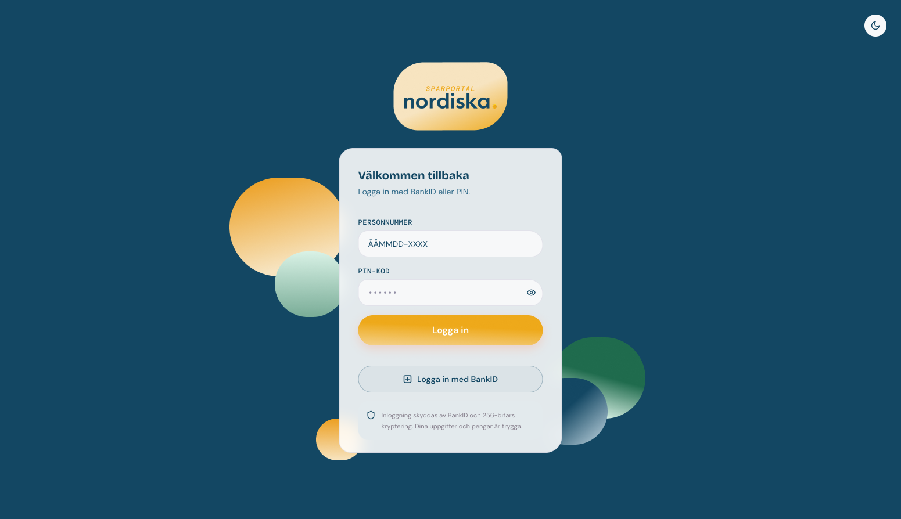 | 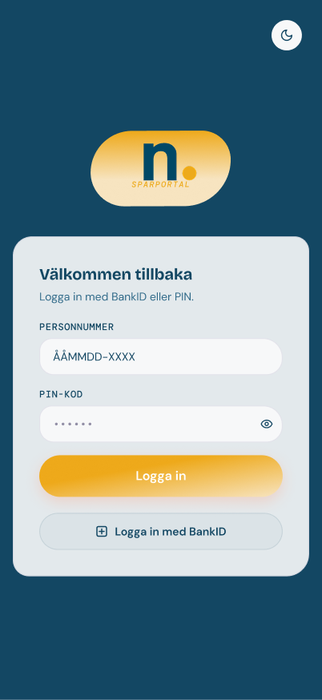 | 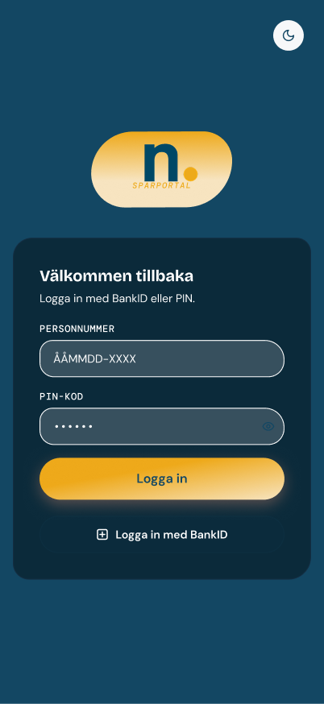 |

#### Dashboard

| Desktop | Mobil, ljust | Mobil, mörkt |
|---------|--------------|--------------|
| 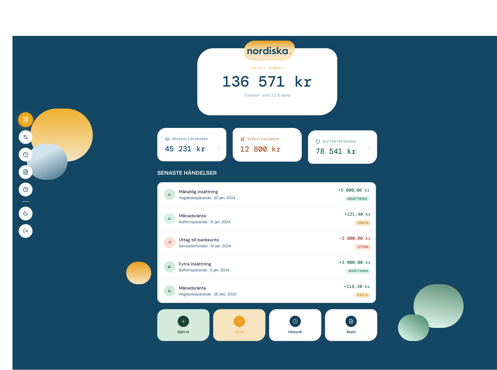 | 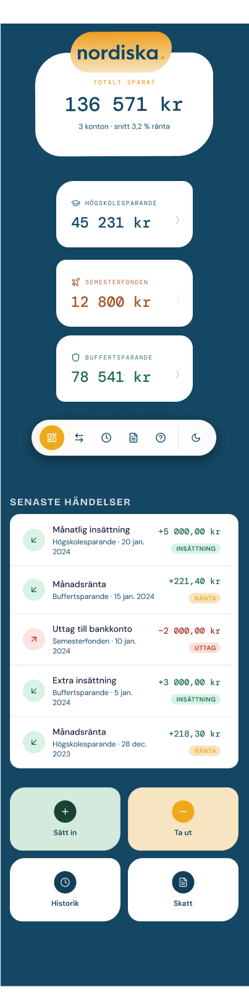 | 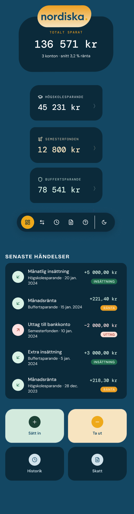 |

#### Flytta pengar

| Desktop | Mobil, ljust | Mobil, mörkt |
|---------|--------------|--------------|
| 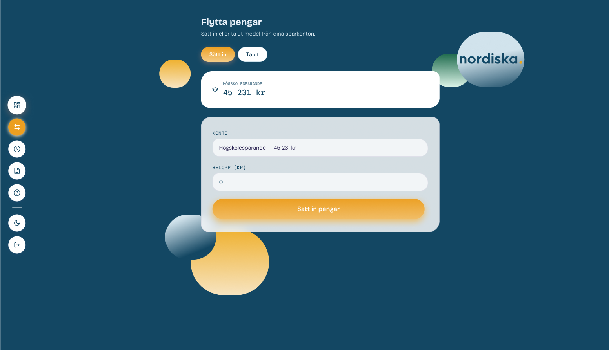 | 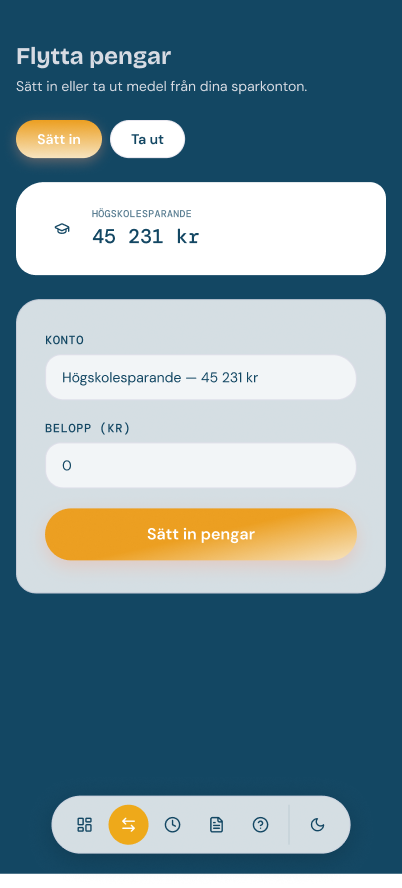 | 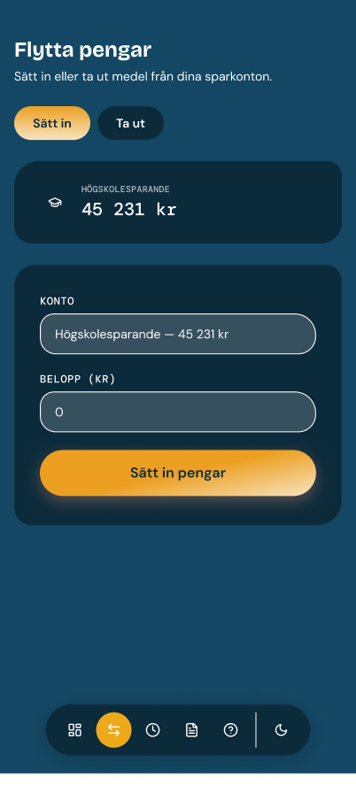 |

#### Transaktionshistorik

| Desktop | Mobil, ljust | Mobil, mörkt |
|---------|--------------|--------------|
| 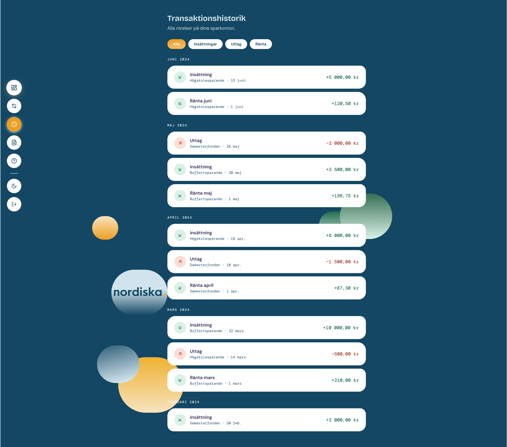 | 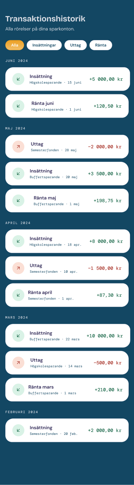 | 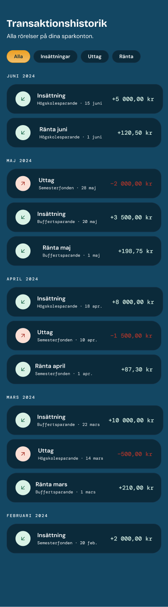 |

#### Skatterapport

| Desktop | Mobil, ljust | Mobil, mörkt |
|---------|--------------|--------------|
| 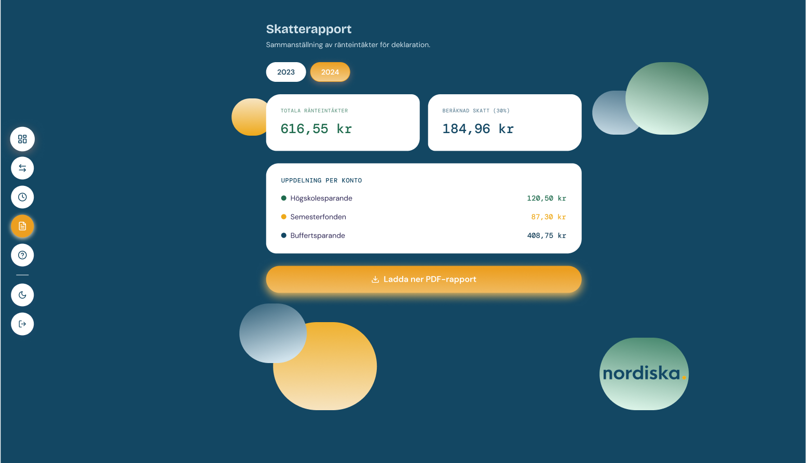 | 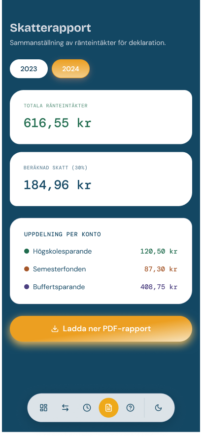 | 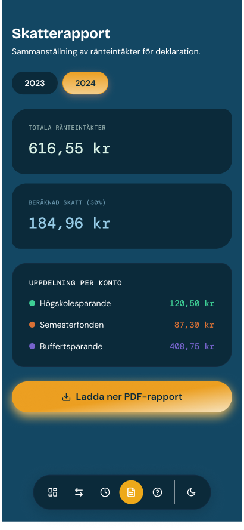 |

#### Vanliga frågor

| Desktop | Mobil, ljust | Mobil, mörkt |
|---------|--------------|--------------|
| 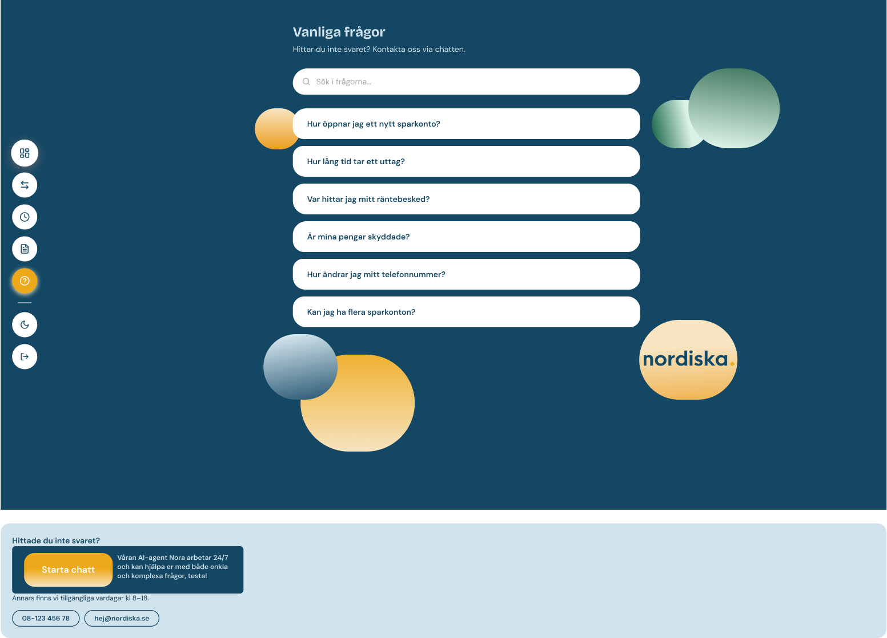 |  |  |

## Backend

API:et bakom sparportalen är byggt i .NET 8, Entity Framework Core och PostgreSQL 15. Det sköter inloggning med PIN eller BankID, konton, insättning, uttag och överföring, ränta, skatterapport som signerad PDF och FAQ. Skatterapporterna skapas av två inbyggda program i `native/` som API:et startar. När du kör lokalt finns Swagger på `/swagger` och hälsokontrollen på `/health`.

### Struktur

`backend/NordiskaPortal.API/` har Controllers, Services (affärslogik), Repositories, Data (DbContext och seed), Migrations, Models, DTOs, Validators, Middleware och Extensions. `backend/NordiskaPortal.Tests/` har xUnit-testerna. `backend/NordiskaPortal/` är v1 och används inte.

### API

Alla endpoints finns i Swagger. I korthet: `/api/auth` (register, login-pin, refresh, me, logout), `/api/auth/bankid`, `/api/accounts` (konton, saldo, deposit, withdraw, transfer, transaktioner), `/api/transactions`, `/api/taxreports` (skapa, lista, PDF, signatur, publik nyckel), `/api/faq` och `/api/health`. Allt kräver inloggning utom register, login-pin, refresh, BankID och health.

### Så är det byggt

- **Pengar:** saldot räknas ur en huvudbok (`LedgerEntry`), med radlås och en transaktion per order. Insättning, uttag och överföring tar en valfri `Idempotency-Key`.
- **Inloggning:** PIN med BCrypt, spärr efter fem fel (HTTP 423), JWT (15 minuter) och refresh-token i en HttpOnly-cookie (30 minuter). Personnummer krypteras och maskas.
- **Skydd:** rate limiting, säkerhetsheaders och en audit-logg med hashkedja.
- **Ränta:** Riksbankens styrränta plus påslag per kontotyp. Upplupen ränta visas på kontot och betalas ut 1 januari.
- **Skatterapport:** skapas i en kö av `pdf_generator`, signeras av `pdf_signer` och blir `READY` först när signaturen är verifierad. Kontrollera den med `openssl dgst -sha256 -verify <publik nyckel> -signature <fil>.pdf.sig <fil>.pdf`.

### Avgränsningar

- BankID är mockat lokalt (`BankId__Mode=Mock`), kan köras mot BankIDs testmiljö (`Test`) och är avstängt på stage (`Off`).
- Räntan betalas ut en gång om året, den 1 januari.
- Skatterapporter fungerar bara i Docker.

Alla inställningar för backend finns i [backend/.env.example](../backend/.env.example), och fler brister finns i [kända brister](backend/kanda-brister.md).

## Miljöer och deploy

| Miljö | Gren | Adress |
|-------|------|--------|
| Lokalt | | `http://localhost:5077` |
| Stage | `develop` | https://nordiska-team3-dev.team.chas-challenge.comerit.se |
| Prod | `main` | https://nordiska-team3.team.chas-challenge.comerit.se |

Vi arbetar i feature-grenar som slås ihop med `dev` via pull request. När `dev` är redo slås den ihop med `develop` (stage) och sedan med `main` (prod). En push till `develop` eller `main` bygger om respektive miljö. Mer om drift och deploy finns i [DRIFT.md](../DRIFT.md).

## Dokumentation

| Del | Dokument |
|-----|----------|
| Frontend | [frontend/README.md](../frontend/README.md) |
| Backend | [beslutslogg](backend/beslutslogg.md), [teststatus](backend/teststatus.md), [kända brister](backend/kanda-brister.md), [fallback](backend/fallback.md) och [feed forward](backend/feedforward.md) |
| Inbyggda program | [native/README.md](../native/README.md) och [native/docs](../native/docs) |
| Övrigt | [docs/demo-data.md](../docs/demo-data.md), [docs/local-development.md](../docs/local-development.md) och [DRIFT.md](../DRIFT.md) |

Underlag från caset: [docs/v2-targets.md](../docs/v2-targets.md) (krav för v2), [docs/known-bugs.md](../docs/known-bugs.md), [docs/README-pain-points.md](../docs/README-pain-points.md) och [docs/architecture.md](../docs/architecture.md) (beskriver v1).
