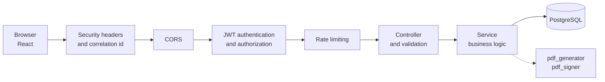
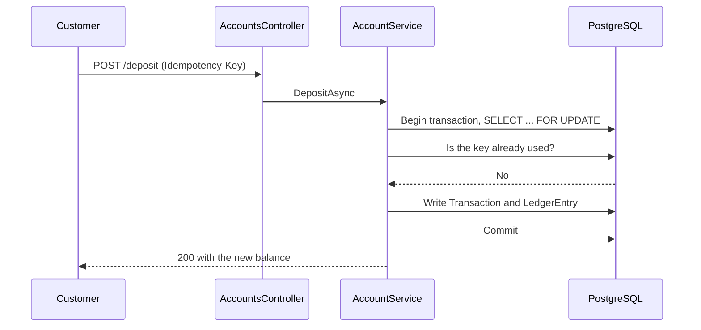
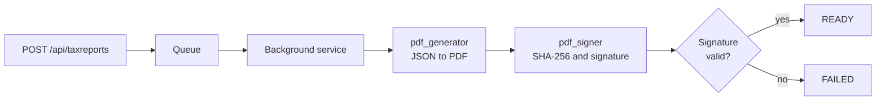
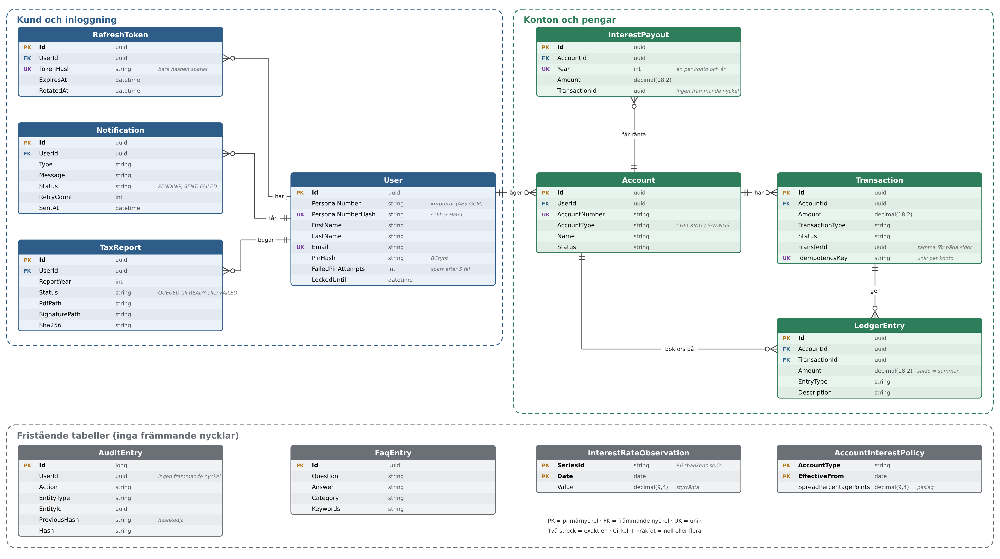

# Project guide

The detailed documentation for Nordiska Sparportal. For a short overview, see the [README](../README.md).

## Contents

1. [Getting started](#getting-started)
2. [Demo accounts and login](#demo-accounts-and-login)
3. [How it is built](#how-it-is-built)
   - [Request flow](#request-flow)
   - [How money is handled](#how-money-is-handled)
   - [How the tax report is made](#how-the-tax-report-is-made)
   - [Database](#database)
   - [API endpoints](#api-endpoints)
   - [Folder structure](#folder-structure)
4. [From v1 to v2](#from-v1-to-v2)
5. [BankID](#bankid)
   - [The three modes](#the-three-modes)
   - [Switching mode locally](#switching-mode-locally)
   - [Try Mock](#try-mock)
   - [Try Test](#try-test)
   - [BankID troubleshooting](#bankid-troubleshooting)
6. [Running the frontend separately](#running-the-frontend-separately)
7. [Quality: tests and CI](#quality-tests-and-ci)
8. [What is not included](#what-is-not-included)
9. [How we worked](#how-we-worked)
10. [Troubleshooting](#troubleshooting)
11. [More documentation](#more-documentation)

## Getting started

You need Git and Docker Desktop (running). Ports 5077 and 5432 must be free. Nothing else has to be installed and you do not need a `.env` file.

```bash
git clone https://github.com/chas-challenge-2026/nordiska-team3.git
cd nordiska-team3/infra
docker compose up --build
```

Then open `http://localhost:5077`. Docker creates the database and the keys, and locally the demo data is loaded automatically.

Good to know:

- Stop with `docker compose down`. `docker compose down -v` also removes the database and the keys, so you start from scratch.
- Changes only show up after you rebuild with `--build`.
- The API documentation is at `/swagger` and the health check at `/health`.
- To run without Docker, see [docs/local-development.md](local-development.md). All settings are listed in [backend/.env.example](../backend/.env.example).

## Demo accounts and login

Every demo customer has the PIN `1234`. These are fictional accounts:

| Name | Personal number |
|------|-----------------|
| Demo Kund | 19850615-5678 |
| Anna Lindqvist | 19880312-4421 |
| Erik Johansson | 19810927-1136 |
| Sara Nilsson | 19930504-7782 |
| Omar Hassan | 19790218-3355 |

More accounts and what they contain: [docs/demo-data.md](demo-data.md). Stage and prod only contain demo data.

To try the API in Swagger, run `POST /api/auth/login-pin`, copy the `accessToken` and paste it under **Authorize** without the word "Bearer". BankID login is described [below](#bankid).

## How it is built

### Request flow

Every request passes the same chain before it reaches the business logic:



### How money is handled

Money is stored as entries in a ledger, not as a number that gets overwritten. Every order locks the account row, checks an optional `Idempotency-Key` and writes everything in one transaction:



### How the tax report is made

The report is queued and created in the background. It becomes `READY` only after the signature has been verified:



Verify a report yourself: `openssl dgst -sha256 -verify <public key> -signature <file>.pdf.sig <file>.pdf`.

### Database



The balance is the sum of the entries in `LedgerEntry`. The audit log (`AuditEntry`) is a hash chain that the database does not allow to be changed afterwards.

### API endpoints

All endpoints are listed in Swagger. In short: `/api/auth`, `/api/auth/bankid`, `/api/accounts`, `/api/transactions`, `/api/taxreports`, `/api/faq` and `/api/health`. Everything requires login except register, login-pin, refresh, BankID and health.

### Folder structure

```text
backend/NordiskaPortal.API/     The API: Controllers, Services, Repositories, Data, Migrations
backend/NordiskaPortal.Tests/   xUnit tests
backend/NordiskaPortal/         v1, not used
frontend/                       The React app, built into the same Docker image as the API
native/                         The C/C++ programs for PDF and signing
infra/                          Docker Compose, local override and seed
docs/                           demo data, running locally, v1 documents
docs v2/                        decision log, test status, known issues, fallback (in Swedish)
DRIFT.md                        how stage and prod are built (in Swedish)
```

## From v1 to v2

These were the problems we found in v1, and what we did about them.

| Problem in v1 | Our solution |
|---------------|--------------|
| Concurrent deposits corrupted the balance (no transaction, no row lock) | A ledger with row locks and one transaction per order. Transfers are atomic. |
| Passwords were hashed with MD5 | PIN with BCrypt, lock after five failed attempts (HTTP 423), and BankID as an alternative |
| Sessions lasted a year and logging out did not end them on the server | A 15 minute JWT and a refresh token that is hashed per device, rotated on use and valid for 30 minutes |
| The tax report blocked the request thread with `Thread.Sleep` and timed out above about 200 transactions | A queue and a background service. The PDF and its signature come from our own native programs. |
| The FAQ returned the first keyword match | Search with scoring and a threshold. Below the threshold the customer is referred to customer service. |
| Confirmation e-mails were sent inside the request and failures were silently swallowed | E-mails are queued and retried by a background service (the sending itself is simulated) |
| Interest was a hardcoded formula in the view layer | Riksbank policy rate plus a margin per account type, calculated in a service and paid out on 1 January |
| No logs, no health check, no tests, credentials in the source code | Serilog with correlation IDs, a `/health` endpoint, 420 tests, and secrets generated in Docker volumes and never stored in the repo |

New in v2: BankID login, encrypted and masked personal numbers, an audit log built as a hash chain, signed tax reports, and an optional `Idempotency-Key` so that a repeated request is not booked twice.

All decisions with dates, reasons and PR numbers: [decision log](../docs%20v2/beslutslogg.md) (in Swedish).

## BankID

BankID has three modes, chosen with the setting `BankId__Mode`. PIN login always works, whatever the mode.

### The three modes

| Mode | What it does | Used in |
|------|--------------|---------|
| `Off` | BankID is switched off. This is the default if nothing is set. | Stage and prod |
| `Mock` | A fake BankID in memory. You approve yourself in the panel "Mock-läge (utveckling)". Only works in Development, otherwise the API refuses to start. | Locally in Docker (default) |
| `Test` | BankID's real test server. You scan the QR code or open BankID on the same device. | Locally, to show that it works for real |

### Switching mode locally

Create the file `infra/.env` (it is git-ignored) with one line:

```
BANKID_MODE=Test
```

Write `Mock`, `Test` or `Off`. Then restart from `infra`. The first time you switch to `Test`, rebuild so that the test certificates are included:

```bash
docker compose up -d --build app
```

Check the mode with `curl -X POST http://localhost:5077/api/auth/bankid/start`. The response contains `mock: true` in Mock, `mock: false` in Test and the error 502 in Off.

### Try Mock

1. Click **Logga in med BankID** (log in with BankID).
2. Enter a demo customer's personal number in the panel **Mock-läge (utveckling)**, for example `19880312-4421`.
3. Click **Simulera godkännande** (simulate approval).

The panel is only shown when the API answers `mock: true`.

### Try Test

The test certificates are in `backend/NordiskaPortal.API/Certs/` and the password `qwerty123` is public. You need:

1. **A phone in test mode.** Reinstall the BankID app, switch on airplane mode, go to Settings, Support, press and hold "Felinformation" and type `kundtest`. Check that it says CUST and force-close the app. The real BankID disappears from the phone until you reinstall the app, so preferably use a spare phone.
2. **A test BankID** for a personal number from the Swedish Tax Agency's test persons, created on BankID's test site. Our demo personal numbers do not pass BankID's check digit.
3. **A customer with the same personal number.** Register it with `POST /api/auth/register`. BankID login does not create accounts, and if the customer is missing you get the error "userNotFound".
4. **The mode `Test`**, as described above.

### BankID troubleshooting

| Problem | Cause and fix |
|---------|---------------|
| The API does not start in `Mock` | `Mock` only works when `ASPNETCORE_ENVIRONMENT` is `Development`. On stage and prod the mode must be `Off` or `Test`. |
| The API does not start in `Test` | The certificate file is missing or the password is wrong. See `docker compose logs app`. |
| 502 from `/api/auth/bankid/start` | The mode is `Off`, or the server cannot reach BankID. |
| "userNotFound" after approval | The personal number is not a customer here. Register it. |
| The phone app finds no order | The phone is not in test mode, or the test BankID was created for another personal number. |
| The QR code stops working | An order is valid for 30 seconds to start. Start a new login. |

## Running the frontend separately

The frontend is served by the API on `localhost:5077`. For hot reload, run it separately:

1. Start the backend and database: `cd infra`, then `docker compose up --build -d`.
2. Open a new terminal in the root folder: `cd frontend`.
3. Install: `npm install`.
4. Check that `VITE_API_URL` in `frontend/.env.development` is `http://localhost:5077`.
5. Start: `npm run dev`, then open [http://localhost:5173](http://localhost:5173).

Stop with `Ctrl + C`. More about the frontend: [frontend/README.md](../frontend/README.md). Other commands there: `npm run lint` and `npm run build`.

## Quality: tests and CI

Measured on 2026-11-04 on `dev`: **420 tests**, of which 401 pass and 19 are skipped locally because they need Postgres. All 420 run in CI against Postgres 15. Line coverage is 71.8 % for the API project and 80.5 % for Services. One dedicated test locks which endpoints are open, so that nothing becomes open by mistake.

```bash
dotnet test backend/NordiskaPortal.Tests
```

Set `NORDISKA_TEST_DB` to run the Postgres tests, see [docs/local-development.md](local-development.md).

GitHub Actions runs on every push and pull request to `dev`: backend build and tests, frontend lint and build, and a Docker build. A separate check (`infra-guard.yml`) guards the platform contract in [DRIFT.md](../DRIFT.md). More: [test status](../docs%20v2/backend/teststatus.md) (in Swedish).

## What is not included

This is what we deliberately left out, or did not have time for:

- Real BankID. It requires an agreement. We have Mock locally, Test against BankID's test environment and Off on stage.
- Interest is paid out on 1 January (the first time on 2027-01-01) and is fetched from the Riksbank. Without contact with the Riksbank no interest is shown.
- The tax is simplified, 30 % of the interest income, and the report is a basis for the return, not the return itself.
- E-mail is queued and retried, but the sending is simulated.
- Tax reports only work in Docker.
- Out of scope: account history as PDF, closing an account, changing details or PIN, forgotten PIN and withdrawal limits.
- BankID orders, rate limiting and the report queue are kept in memory, so only one instance can run.
- Coverage is not measured in CI.

The full list: [known issues](../docs%20v2/backend/kanda-brister.md) (in Swedish).

## How we worked

An issue is done only when testing, code review and merge are done. Meeting notes were kept until 22 September, and after that those who were left held daily meetings about priorities. Decisions since then are in the pull requests. Victor (CTO), Karl (Delivery Manager) and Emma (UX) gave us feed forward, and most of what concerned the backend we had already done or discussed, see [feed forward](../docs%20v2/backend/feedforward.md) (in Swedish).

## Troubleshooting

| Problem | Fix |
|---------|-----|
| "WSL 2 installation is incomplete" (Windows) | Run `wsl --install` in PowerShell as administrator, restart the computer and start Docker Desktop |
| "port is already allocated" | Close the program using 5077 or 5432, or change the port in `infra/docker-compose.override.yml` |
| Code changes do not show up | Rebuild with `--build` |
| The database is in a strange state | `docker compose down -v` and start over |
| The account is locked | Five wrong PINs lock it for five minutes. Wait or use another demo customer |
| No interest is shown | The server cannot reach api.riksbank.se. Everything else works |
| The tax report becomes `FAILED` | The signing key is missing, see [docs/local-development.md](local-development.md). Locally, `docker compose down -v` helps |
| BankID gives an error on stage | BankID is switched off there. Log in with PIN |

If the live demo fails, see the [fallback](../docs%20v2/fallback.md) (in Swedish).

## More documentation

Most of the detailed documents are written in Swedish.

| Document | Contents |
|----------|----------|
| [Decision log](../docs%20v2/beslutslogg.md) | Decisions, reasons and PR numbers |
| [Test status](../docs%20v2/backend/teststatus.md) | Tests and coverage |
| [Known issues](../docs%20v2/backend/kanda-brister.md) | What is not done |
| [Fallback](../docs%20v2/fallback.md) | If the demo fails |
| [Feed forward](../docs%20v2/backend/feedforward.md) | What the specialists gave us |
| [Frontend](../frontend/README.md) | The frontend in detail |
| [Operations and deploy](../DRIFT.md) | How stage and prod are built |
| [Running locally](local-development.md) | Without Docker, secrets and Postgres tests |
| [Demo data](demo-data.md) | Demo customers and accounts |

`docs/architecture.md`, `docs/known-bugs.md`, `docs/README-pain-points.md` and `docs/v2-targets.md` describe v1 and the assignment and do not apply to v2.