# Nordiska Sparportal — Frontend

Kundportalen för Nordiskas sparkonton. Här loggar kunden in med PIN eller BankID, ser sina sparkonton, sätter in och tar ut pengar, går igenom sin historik, laddar ner skatteunderlag och får hjälp i FAQ:n.

## Kom igång lokalt

Frontend är byggd med React, TypeScript och Vite.

### Förutsättningar

För att köra projektet lokalt behöver du ha följande installerat:

- Node.js och npm
- Docker, exempelvis Docker Desktop

### Starta backend och databas

Se till att Docker är igång. Öppna en terminal i projektets rotmapp och kör:

```bash
cd infra
docker compose up --build -d
```

Backend nås på `http://localhost:5077`. Låt Docker-containrarna vara igång medan du använder applikationen.

### Installera och starta frontend

1. Öppna en ny terminal i projektets rotmapp och gå till frontend:

   ```bash
   cd frontend
   ```

2. Installera projektets beroenden:

   ```bash
   npm install
   ```

3. Kontrollera att `VITE_API_URL` i `frontend/.env.development` pekar på backend:

   ```env
   VITE_API_URL=http://localhost:5077
   ```

4. Starta utvecklingsservern:

   ```bash
   npm run dev
   ```

5. Öppna adressen som visas i terminalen, vanligtvis [http://localhost:5173](http://localhost:5173).

Stoppa utvecklingsservern med `Ctrl + C`.

### Inloggning

#### Personnummer och PIN-kod

Ange personnummer i formatet `ÅÅÅÅMMDD-XXXX` och tillhörande PIN-kod. Klicka sedan på **Logga in**. Vid lyckad inloggning kommer du till dashboarden.

Följande testkonton finns när backendens demodata har lagts in i databasen:

> Kontona nedan är fiktiva testkonton för lokal utveckling.

| Användare | Personnummer | PIN-kod |
|-----------|--------------|---------|
| Demo Kund | 19850615-5678 | 1234 |
| Anna Lindqvist | 19880312-4421 | 1234 |
| Erik Johansson | 19810927-1136 | 1234 |
| Sara Nilsson | 19930504-7782 | 1234 |
| Omar Hassan | 19790218-3355 | 1234 |

#### BankID i utvecklingsläge

Den lokala Docker-konfigurationen använder som standard BankID i mock-läge. Då kan du simulera en inloggning utan BankID-appen:

1. Klicka på **Logga in med BankID**.
2. Ange testkontots personnummer i panelen **Mock-läge (utveckling)**.
3. Klicka på **Simulera godkännande**.

När inloggningen har godkänts kommer du till dashboarden.

### Mappstruktur

```text
frontend/
├── public/             # Statiska filer, exempelvis ikoner
├── src/
│   ├── components/     # Återanvändbara komponenter och dialogrutor
│   ├── content/        # Gemensamt innehåll, exempelvis kontaktuppgifter
│   ├── context/        # Hantering av ljust och mörkt tema
│   ├── hooks/          # Egna React-hooks för data och användarbeteenden
│   ├── Page/           # Sidor för inloggning, dashboard, transaktioner,
│   │                   # historik, skatteunderlag och FAQ
│   ├── schemas/        # Validering av formulär med Zod
│   ├── services/       # API-anrop och autentisering
│   ├── types/          # Gemensamma TypeScript-typer
│   ├── utils/          # Hjälpfunktioner
│   ├── App.tsx         # Routing och skydd av inloggade sidor
│   ├── App.css         # Stilar för applikationen
│   ├── index.css       # Globala stilar
│   └── main.tsx        # Applikationens startpunkt
├── .env.example        # Exempel på miljövariabler
├── .env.development    # API-adress för lokal utveckling
├── .env.production     # Miljövariabler för produktion
├── index.html          # HTML-fil som laddar applikationen
├── package.json        # Beroenden och npm-kommandon
├── package-lock.json   # Låsta versioner av beroenden
├── tsconfig*.json      # TypeScript-konfiguration
└── vite.config.ts      # Vite-konfiguration
```

## UX-tanken

Utgångspunkten var att en sparportal inte ska kännas som en krånglig bankapp. Kunden loggar oftast in för att svara på någon av några få frågor: *Hur mycket har jag sparat? Vad har hänt på mina konton? Hur flyttar jag pengar?* Varje vy är byggd för att svara på en av dem så snabbt som möjligt.

### Vyerna och vad de svarar på

| Vy | Kundens fråga | Hur vi löser det |
|----|---------------|------------------|
| **Inloggning** | "Hur kommer jag in?" | Ett kort med två vägar: PIN eller BankID. Fälten visar formatet (`ÅÅMMDD-XXXX`), felmeddelanden står på svenska under fältet och en rad om säkerhet ger trygghet. |
| **Dashboard** | "Hur mycket har jag?" | Totalt sparat syns först och störst. Därunder ett kort per konto med egen ikon och färg, de senaste händelserna och genvägar till det man oftast gör: Sätt in, Ta ut, Historik och Skatt. |
| **Flytta pengar** | "Hur sätter jag in eller tar ut?" | En växel mellan Sätt in och Ta ut, ett kort som visar valt kontos saldo och bara två fält: konto och belopp. Efter ordern visas ett kvitto som säger vad som hänt och vilket saldo kontot nu har. |
| **Historik** | "Vad har hänt?" | Transaktioner grupperade per månad med filter för Alla, Insättningar, Uttag och Ränta. Pil, färg och tecken (+/−) visar riktningen. |
| **Skatterapport** | "Vad ska jag deklarera?" | Välj år och se totala ränteintäkter, beräknad skatt och uppdelning per konto, och ladda ner PDF med ett klick. |
| **Vanliga frågor** | "Jag behöver hjälp" | Sökfält överst och frågor som fälls ut. Hittar man inte svaret finns chattagenten Nora och kundtjänstens telefon och mejl direkt under. |

### Principer vi följt

- **Det viktigaste först.** Varje vy börjar med en tydlig rubrik och en mening om vad sidan gör, och den viktigaste siffran står överst.
- **Få steg.** Insättning och uttag sker på en sida utan guider eller extra bekräftelsesidor, och kvittot visas på samma ställe.
- **Samma mönster överallt.** Kort, pillerknappar för val (Sätt in/Ta ut, filter, år) och transaktionsrader ser likadana ut i alla vyer, så kunden bara behöver lära sig dem en gång.
- **Tummen först på mobil.** Navigeringen ligger längst ner där tummen når, och knappar och klickytor är stora.
- **Begripligt språk.** All text är på svenska och utan bankjargong: "Sätt in", "Ta ut", "Totalt sparat".
- **Trygghet.** Säkerhetstext vid inloggning, tydliga felmeddelanden, automatisk utloggning vid inaktivitet och kvitto efter varje order.
- **Tillgänglighet.** Kontrast enligt WCAG AA (se nedan), ljust och mörkt tema, färg aldrig som enda signal och `aria-live`/`role="alert"` så att skärmläsare får höra laddning och fel.

### Från skiss till kod

Vi skissade först alla vyer för mobil, i ljust och mörkt tema, och anpassade dem sedan för desktop (se [Första skisserna](#första-skisserna)). Skisserna gav oss komponenterna innan vi skrev någon kod: kontokort, transaktionsrad, pillerknapp och navigering. På så sätt kunde flera personer bygga olika sidor parallellt och ändå få samma utseende.

## Designval

### Färger och formspråk

Färgerna utgår från Nordiskas befintliga färgpalett: den djupa blå basen (`#134763`) och den varma gula (`#eea91a`). Vi har behållit känslan men justerat paletten så att den klarar kontrastkraven i WCAG 2.1 AA (minst 4.5:1 för vanlig text):

| Användning | Färger | Kontrast |
|------------|--------|----------|
| Gul text på vit bakgrund (originalfärgen) | `#eea91a` på `#ffffff` | 2.0:1, underkänt |
| Gul text på ljus bakgrund (vår mörkare ton) | `#7d570a` på `#ffffff` | 6.5:1 |
| Knappar: blå text på gul bakgrund | `#134763` på `#eea91a` | 4.9:1 |
| Blå text på ljusa kort | `#134763` på `#d7e7ef` | 7.9:1 |
| Insättning/ränta (grön) | `#2f6b50` på `#ffffff` | 6.3:1 |
| Uttag (röd) | `#b23a2e` på `#ffffff` | 5.9:1 |

Därför används originalgult bara som yta (knappar, aktiva val, dekor) och aldrig som textfärg på ljus bakgrund. Det mörka temat har egna, ljusare toner som är anpassade på samma sätt. Grönt används för insättningar och ränta och rött för uttag, men typen står alltid också i text och visas med en pil, så att färg aldrig är det enda sättet att förstå en transaktion.

Kort, knappar och fält har kraftigt rundade hörn, och mjuka färgade cirklar ([DecorativeCircle.tsx](src/components/DecorativeCircle.tsx)) ligger i bakgrunden på desktop. Tanken är att en sparportal ska kännas lugn och vänlig snarare än som en kall bankapp.

### Typsnitt

- **Rubriker:** Poppins, för en tydlig och lite rundare känsla.
- **Brödtext:** Inter / systemtypsnitt, för läsbarhet.
- **Belopp:** monospace, så att siffror och kronor linjerar i listor och kort.

### Ljust och mörkt tema

Alla färger går via semantiska tokens (`--color-surface`, `--color-text-primary` osv.) som skrivs om under `[data-theme="dark"]`. Temat styrs av [ThemeContext.tsx](src/context/ThemeContext.tsx), sparas i `localStorage` och växlas med måne/sol-knappen i navigeringen.

### Mobil först

Vyerna är skissade för mobil först och skalas sedan upp:

- **Mobil:** navigeringen är en flytande menyrad längst ner, korten ligger i en kolumn.
- **Desktop:** navigeringen flyttar till en vertikal rad ikoner till vänster, innehållet hålls i en smal centrerad kolumn (`--desktop-content-width`) och korten kan ligga bredvid varandra.

### Säkerhet i gränssnittet

- Access-token ligger bara i minnet, inte i `localStorage`. En HttpOnly refresh-cookie återställer sessionen vid omladdning ([authService.ts](src/services/authService.ts)).
- [apiClient.ts](src/services/apiClient.ts) försöker förnya token en gång vid `401` och skickar annars användaren till inloggningen.
- [useIdleLogout.ts](src/hooks/useIdleLogout.ts) loggar ut efter 15 minuters inaktivitet.

## Kända brister och avgränsningar

### Kända brister

- **Inga automatiska tester.** Frontend saknar enhets- och end-to-end-tester. CI kör bara `npm run lint` och `npm run build`.
- **Profilinställningar sparas inte.** Namn och e-post i [ProfileSettingsModal.tsx](src/components/ProfileSettingsModal.tsx) går att ändra, men ändringen ligger bara kvar i komponenten och skickas inte till backend.
- **Periodfiltret i historiken gäller bara den hämtade sidan.** Typ och konto filtreras i backend, men "Senaste 30 dagarna" och "I år" filtreras i frontend på de 20 transaktioner som redan hämtats. En sida kan därför visa färre rader än väntat trots att det finns fler träffar på andra sidor.
- **Kontots ikon och färg sparas bara i webbläsaren.** Valen ligger i `localStorage` ([accountPresentation.tsx](src/utils/accountPresentation.tsx)) och följer inte med till en annan enhet eller webbläsare.
- **Ingen 404-sida.** En okänd adress visar en tom sida i stället för ett meddelande och en väg tillbaka.
- **Ingen felgräns (error boundary).** Ett oväntat fel när en komponent renderas ger en tom sida i stället för ett felmeddelande.

### Avgränsningar

- **Bara rörligt sparande.** Fast ränta finns som val när man öppnar ett nytt konto men är markerat "Kommer senare" och går inte att välja.
- **En inloggning per flik.** Sessionen gäller fliken den skapades i. En ny flik eller ett nytt fönster kräver ny inloggning.
- **Bara svenska.** Gränssnittet finns inte på andra språk.
- **BankID testas i mock-läge.** Lokalt simuleras godkännandet i panelen **Mock-läge (utveckling)** i stället för med BankID-appen.

## Första skisserna

Skisserna gjordes innan vi började koda och har varit utgångspunkten för komponenterna. Den färdiga appen har ändrats en del sedan dess, men färger, kort och navigering kommer härifrån.

### Inloggning

| Desktop | Mobil, ljust | Mobil, mörkt |
|---------|--------------|--------------|
| 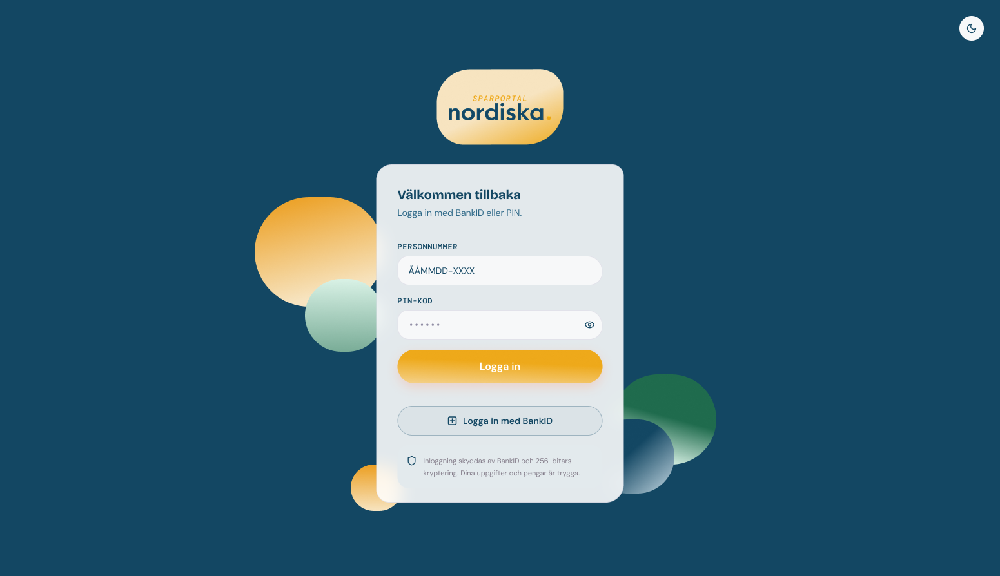 | 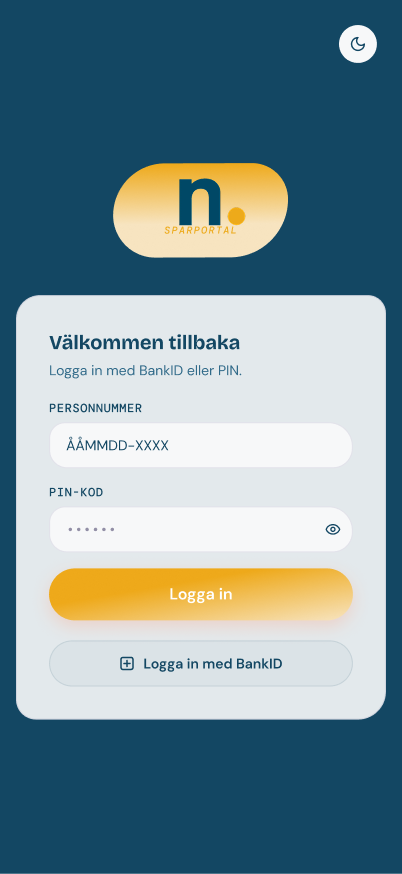 | 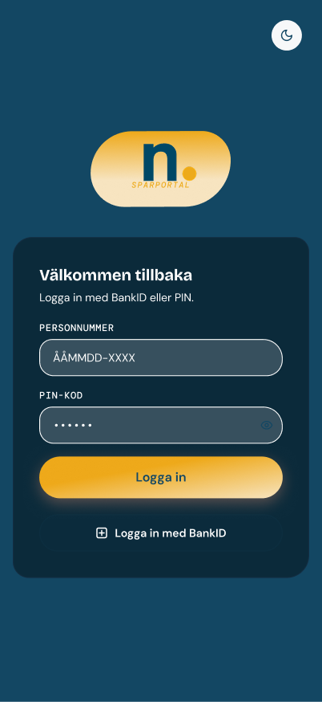 |

### Dashboard

| Desktop | Mobil, ljust | Mobil, mörkt |
|---------|--------------|--------------|
| 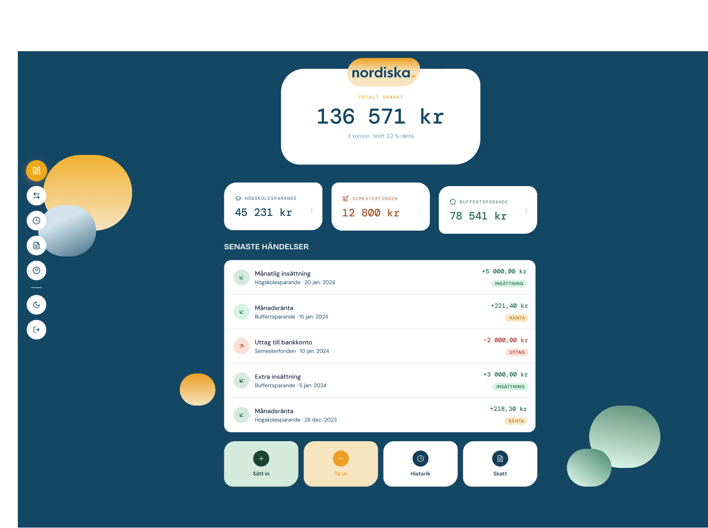 | 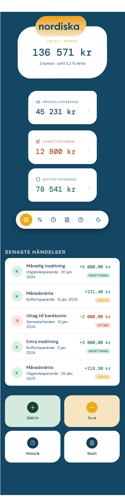 | 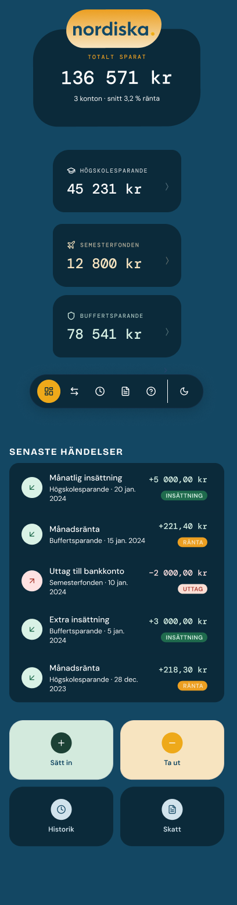 |

### Flytta pengar

| Desktop | Mobil, ljust | Mobil, mörkt |
|---------|--------------|--------------|
| 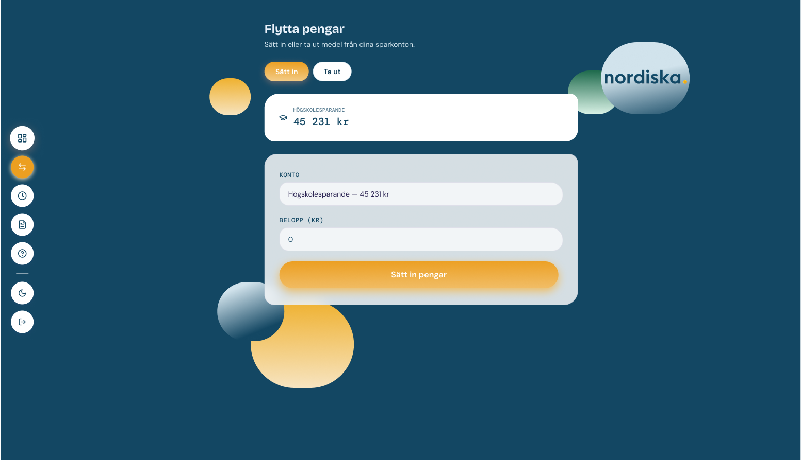 | 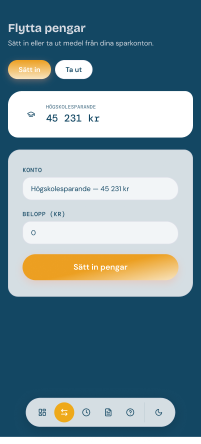 | 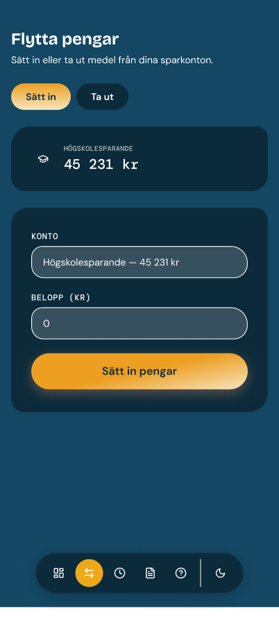 |

### Transaktionshistorik

| Desktop | Mobil, ljust | Mobil, mörkt |
|---------|--------------|--------------|
| 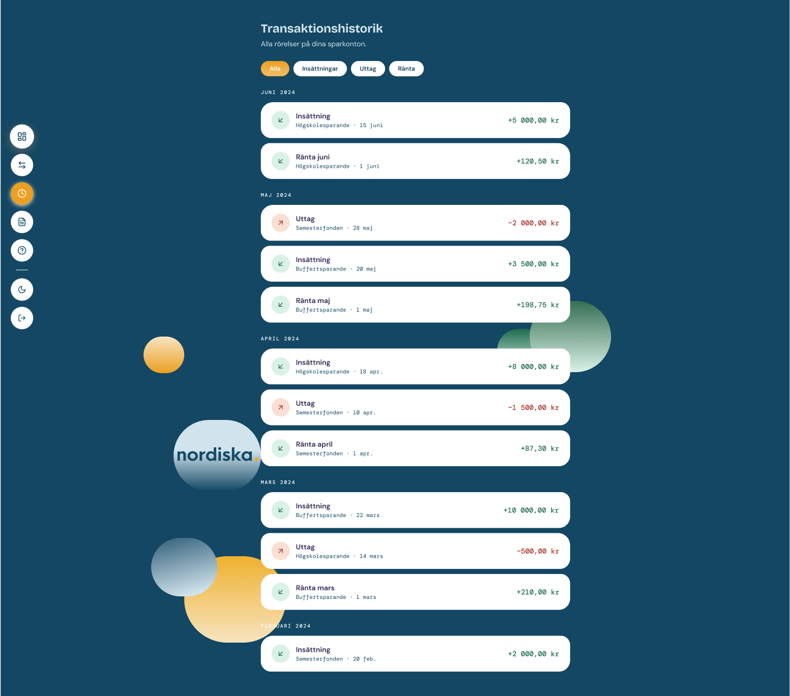 | 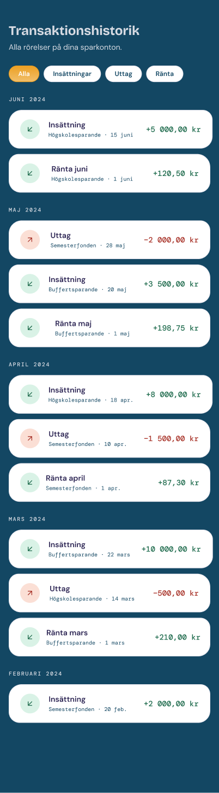 | 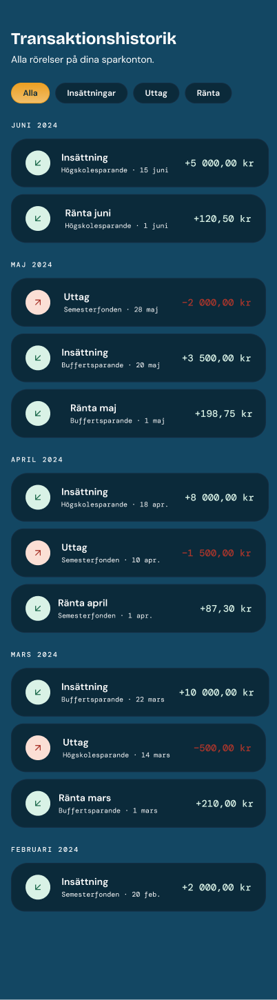 |

### Skatterapport

| Desktop | Mobil, ljust | Mobil, mörkt |
|---------|--------------|--------------|
| 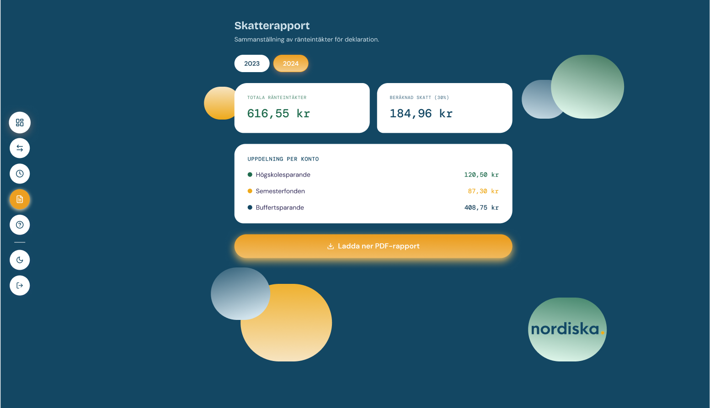 | 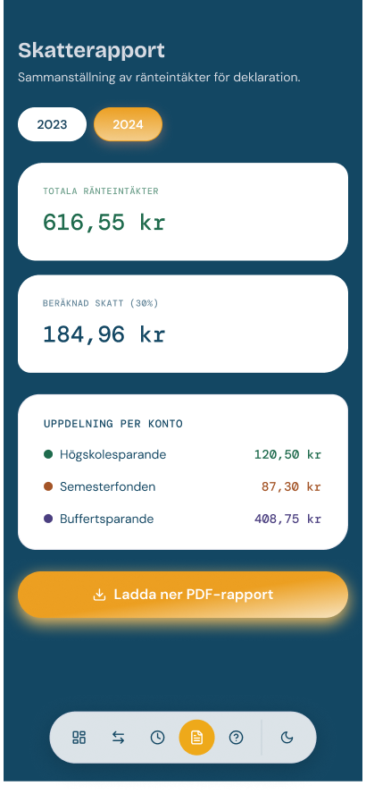 | 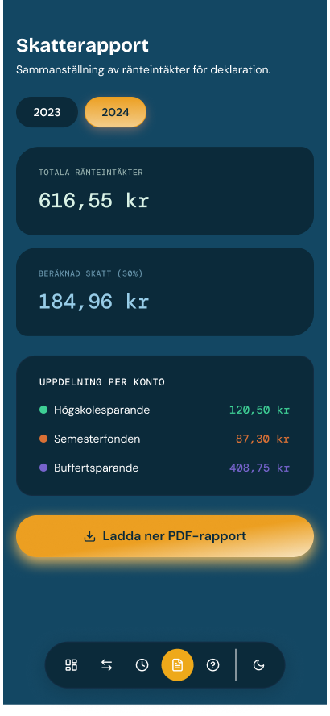 |

### Vanliga frågor

| Desktop | Mobil, ljust | Mobil, mörkt |
|---------|--------------|--------------|
| 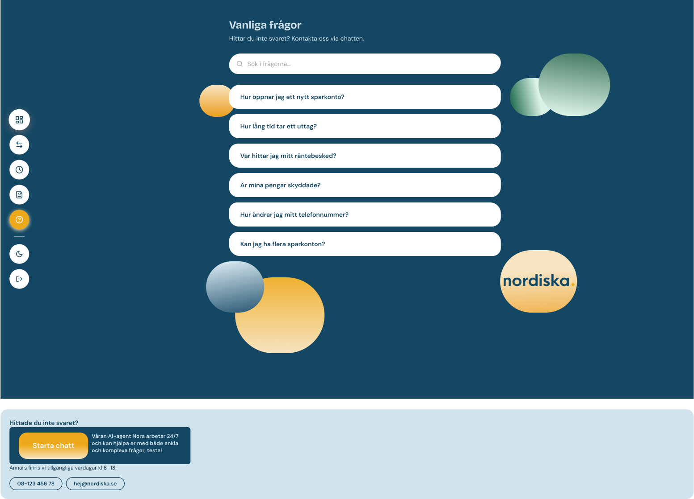 |  |  |
